

# Pill Point Delivery

**Get your medication delivered fast, right to your doorstep!**

An Android-based medication ordering and delivery application built with Kotlin, XML, and Firebase.

---

## Table of Contents
- [Project Overview](#-1-project-overview)
- [Purpose of the Application](#-2-purpose-of-the-application)
- [Target Users](#-3-target-users)
- [Main Application Features](#-4-main-application-features)
- [Innovative Features](#-5-innovative-features)
- [Design Considerations](#-6-design-considerations)
- [Technologies and Development Tools](#-7-technologies-and-development-tools)
- [Firebase Integration & Database Structure](#-8-firebase-integration--database-structure)
- [GitHub & GitHub Actions CI Pipeline](#-9-github--github-actions-ci-pipeline)
- [Google Play Store Deployment](#-10-google-play-store-deployment)
- [Application Testing & Results](#-11-application-testing--results)
- [Release Notes & Prototype Updates](#-12-release-notes--prototype-updates)

---

## Project Overview

**Pill Point Delivery** is an Android application developed to improve access to medication by providing customers with a convenient digital platform for ordering medication and accessing pharmacy services. 

The application addresses challenges associated with traditional pharmacy visits, including long queues, transportation difficulties, illness, limited mobility, and general inconvenience for individuals requiring regular treatment.

---
## Purpose of the Application

The main purpose of the application is to make accessing medication easier, faster, and more convenient by:
* Reducing the need for customers to physically visit pharmacies.
* Providing a convenient digital medication ordering platform.
* Improving access to medication for elderly individuals and people with limited mobility.
* Allowing customers to submit prescriptions electronically.
* Helping customers remember their medication schedules.
* Providing access to pharmacy locations and order tracking.

---

## Target Users

* Individuals who require regular or chronic medication.
* Elderly people who experience difficulties travelling to physical pharmacies.
* People with disabilities or limited mobility.
* Busy customers who prefer online ordering and home delivery.

---

## Main Application Features

| Feature | Description |
| :--- | :--- |
| **User Registration & Login** | Secure customer account creation and authentication managed via Firebase Authentication. |
| **Centralised Dashboard** | Clean navigation hub connecting customers to all core services. |
| **Medication Shop** | Browse available medication, view pricing details, and add items to cart. |
| **Shopping Cart** | Manage item quantities, calculate subtotals, apply delivery fees (R50.00), and sync data with Firebase Firestore. |
| **Checkout** | Enter delivery details, select payment methods, and save orders directly to Firestore. |
| **Prescription Upload** | Electronic submission of prescriptions to cut down on unnecessary physical visits. |
| **Medication Reminders** | Schedule reminders to support adherence for chronic medication users. |
| **Store Locator** | Map-based tool to help customers identify nearby pharmacy locations. |
| **Order Tracking & My Orders** | View previously placed orders and check available delivery status updates. |
| **My Account** | View and manage personal customer profile information. |

---

## Innovative Features

* **Integrated Medication Ordering:** Seamless workflow from medication browsing and cart management straight to checkout in one app.
* **Electronic Prescription Submission:** Eliminates unnecessary travel by digitizing prescription drop-offs.
* **Medication Reminders:** Built-in adherence tools for patients managing daily schedules.
* **Pharmacy Store Locator:** Interactive location support for finding nearby pharmacy services.
* **Firebase-Based Data Management:** Cloud Firestore persistence ensuring user carts and orders stay synced across sessions.
* **Automated CI/CD Pipeline:** Continuous testing and building via GitHub Actions.

---

## Design Considerations

* **User Interface Design:** Uses a healthcare-inspired colour palette featuring **Light Blue (`#DFEEF3`)**, **Dark Blue (`#003049`)**, **White (`#FFFFFF`)**, and supporting red accents for visual consistency.
* **Navigation & Layout:** Combines a centralised dashboard with a structured navigation drawer to reduce the steps needed to complete an order.
* **Accessibility:** Designed specifically for elderly individuals and people with limited mobility with clear typography and straightforward workflows.
* **Data Management & Security:** Protected by Firebase Authentication and Firestore security rules so customers can only access authorised personal and prescription records.
---

## Technologies and Development Tools

| Technology | Purpose |
| :--- | :--- |
| **Android Studio** | Main IDE (Compile/Target SDK: 36, Min SDK: 24) |
| **Kotlin & XML** | Core application logic and UI layout design |
| **Firebase Authentication** | User registration, login, and UID management |
| **Firebase Cloud Firestore** | Cloud NoSQL database storage |
| **Gradle & Java 17** | Build automation and dependency management |
| **GitHub & GitHub Actions** | Version control, automated unit testing, and CI builds |
| **Google Play Console** | Release packaging (AAB) and Play Store distribution |

---

## Firebase Integration & Database Structure

Cloud Firestore stores and retrieves application records tied to each customer's unique Firebase UID across seven main collections:
* `users` – Customer account and profile information.
* `medications` – Medication catalog and product pricing details.
* `cart` – Customer-specific shopping cart items.
* `orders` – Submitted customer orders and delivery details.
* `prescriptions` – Electronic prescription submission records.
* `reminders` – Medication reminder schedules.
* `pharmacies` – Pharmacy locations and store details.

---

## GitHub & GitHub Actions CI Pipeline

The repository uses GitHub Actions (`Pill Point Delivery - Automated Tests`) to automatically test and build the application on pushes and pull requests:
1. Checks out repository code and configures **Java 17** and **Gradle**.
2. Securely restores `google-services.json` using the encrypted GitHub secret `FIREBASE_CONFIG_BASE64`.
3. Executes unit test suites (`AppValidationTest` and `ReminderValidationTest`).
4. Builds the Android application and uploads test reports as workflow artifacts.

---
## Application Testing & Results

Automated unit testing and manual functional testing verified core workflows (registration, login, cart calculations, Firestore order creation, and navigation):

* **Total Unit Tests:** 37
* **Successful Tests:** 37
* **Failed Tests:** 0
* **Success Rate:** **100%**

---
## Google Play Store Deployment

To make **Pill Point Delivery** accessible to real-world users, the application was packaged as a signed **Android App Bundle (`.aab`)** and uploaded to the **Google Play Console**.

* **Package Name:** `com.example.pillpoint`
* **Release Track:** Internal / Closed Testing Track
* **Store Listing Assets:** Configured app icon, feature graphic, privacy policy declaration, and mobile screenshots.

  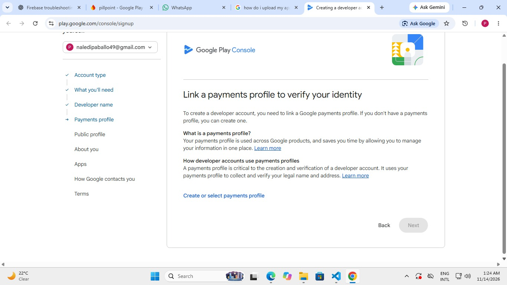 
  <i>Pill Point Delivery uploaded and configured on the Google Play Console</i>

---
### Google Play Console Setup Gallery

  
<b>Click to expand and view all deployment screenshots (12 images)</b>

   

  <table align="center">
    <tr>
      <td align="center" width="50%">
        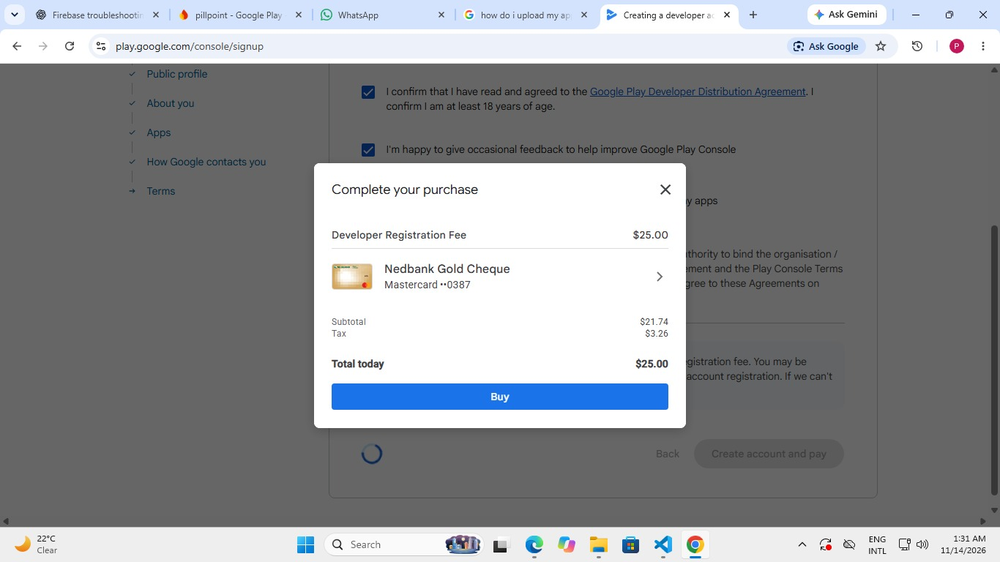 
        <b>Step 1: Play Console Setup</b>
      </td>
      <td align="center" width="50%">
        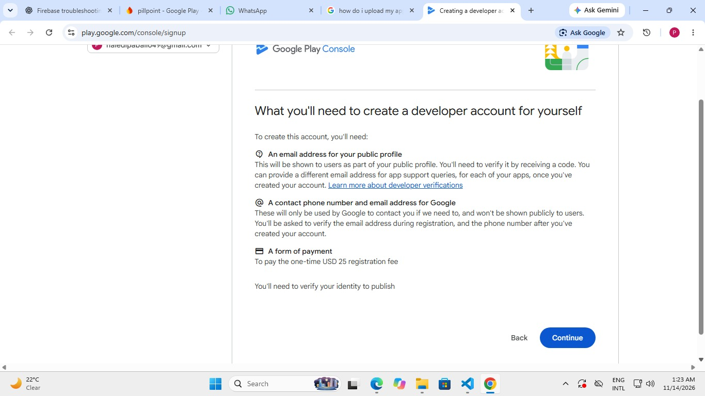 
        <b>Step 2: App Details & Configuration</b>
      </td>
    </tr>
    <tr>
      <td align="center" width="50%">
        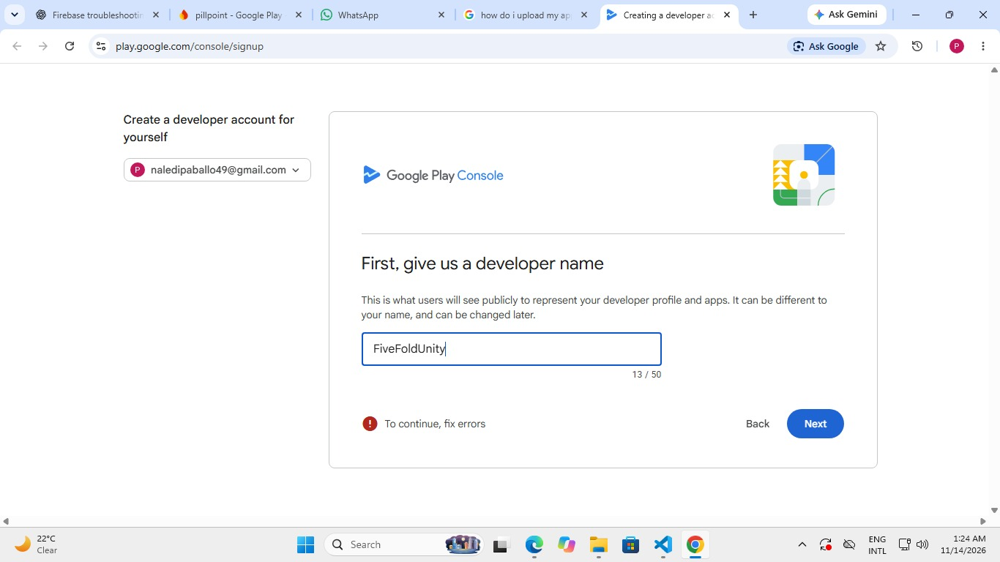 
        <b>Step 3: Store Listing Setup</b>
      </td>
      <td align="center" width="50%">
        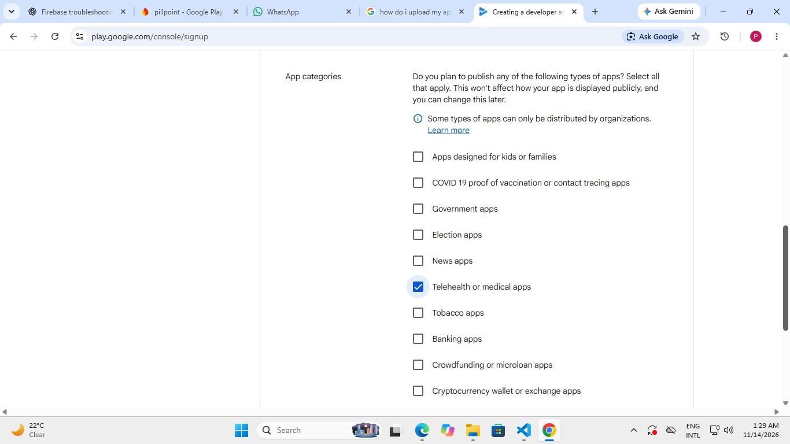 
        <b>Step 4: App Bundle / Release Overview</b>
      </td>
    </tr>
    <tr>
      <td align="center" width="50%">
        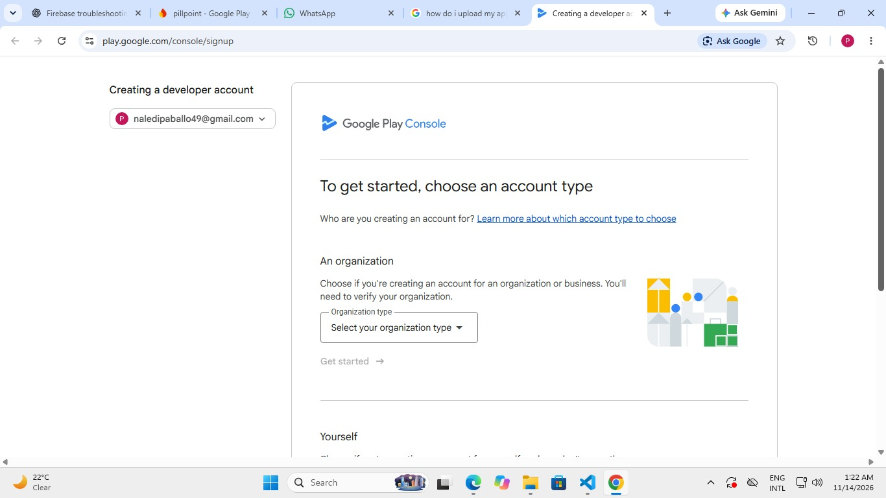 
        <b>Step 5: Internal Testing Track</b>
      </td>
      <td align="center" width="50%">
        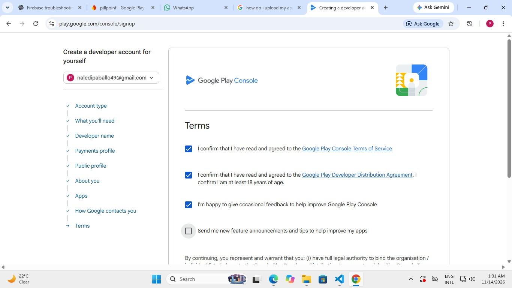 
        <b>Step 6: Testers Management</b>
      </td>
    </tr>
    <tr>
      <td align="center" width="50%">
        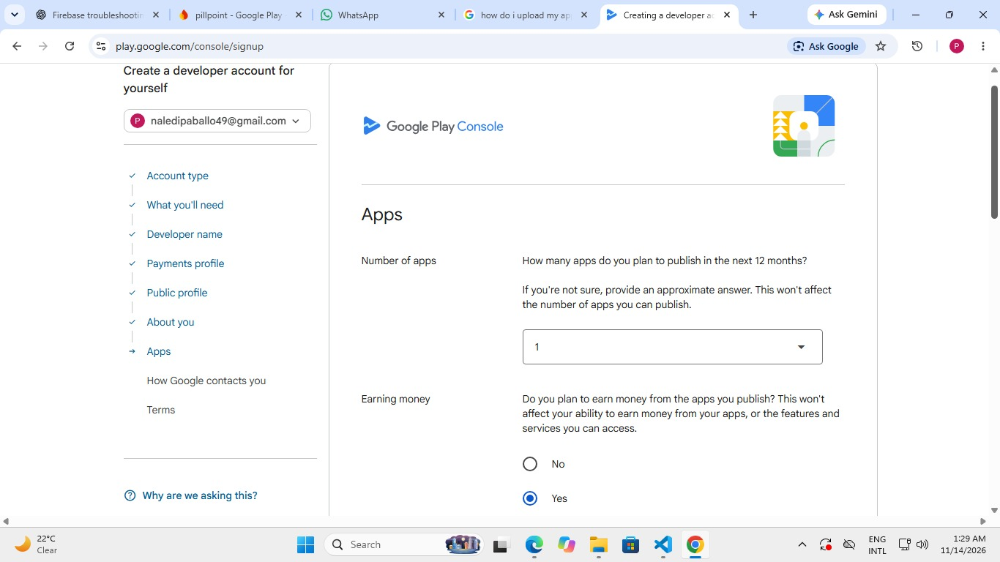 
        <b>Step 7: Release Creation</b>
      </td>
      <td align="center" width="50%">
        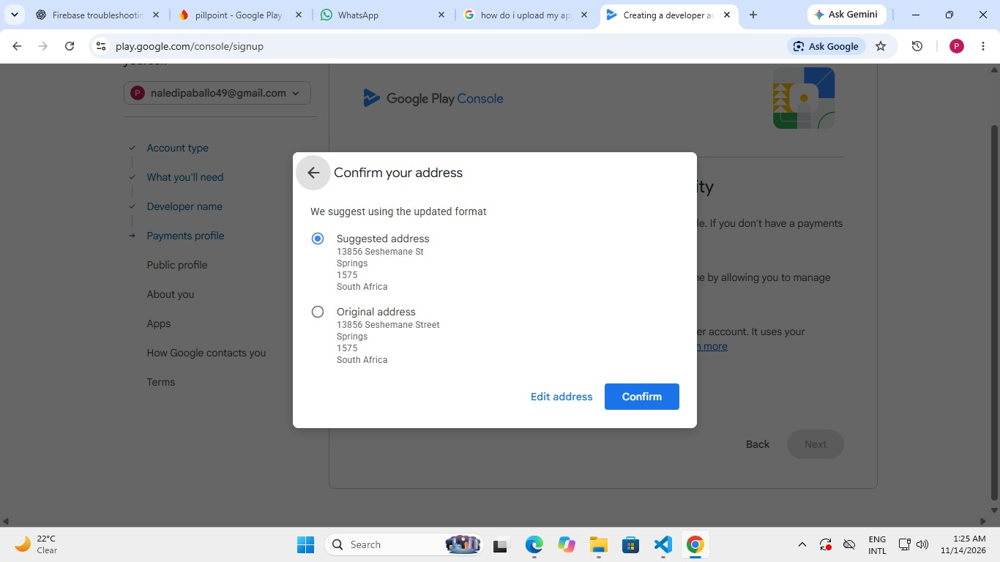 
        <b>Step 8: Content Rating Questionnaire</b>
      </td>
    </tr>
    <tr>
      <td align="center" width="50%">
        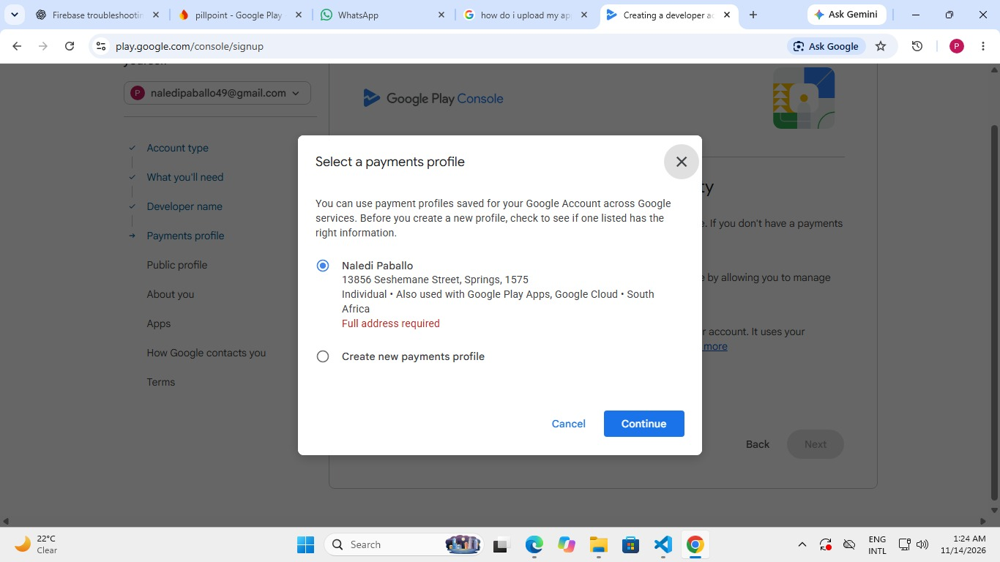 
        <b>Step 9: Privacy Policy & Declarations</b>
      </td>
      <td align="center" width="50%">
        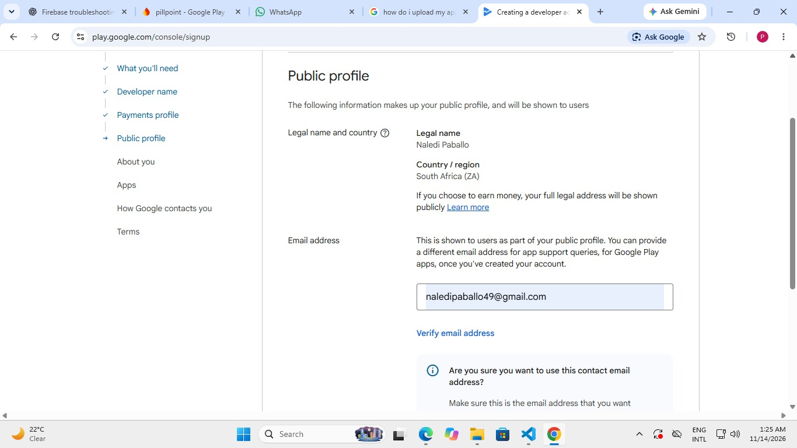 
        <b>Step 10: Final Review & Rollout</b>
      </td>
    </tr>
  </table>

---

## Release Notes & Prototype Updates

### Version 1.0.0 – Final Project Release

**Overview:**  
Version 1.0.0 marks the transition of **Pill Point Delivery** from an early conceptual prototype into a cloud-connected, production-ready Android application with Firebase integration, automated CI testing, and Play Store deployment.

#### Major Updates Made Since the Prototype:
1. **Database Migration:** Replaced the initial local/MySQL-PHP prototype structure with **Firebase Cloud Firestore** and **Firebase Authentication** for real-time user data persistence.
2. **Dynamic Shopping Cart & Checkout:** Upgraded from static mock screens to live Firestore-synced carts with automatic subtotal, R50.00 delivery fee calculation, and order creation.
3. **Electronic Prescription Upload:** Added functional digital prescription submission workflows.
4. **Medication Reminders & Store Locator:** Introduced adherence reminders and interactive pharmacy location search.
5. **Automated Testing & Play Store Readiness:** Added 37 unit tests automated via GitHub Actions and generated a signed release bundle for Google Play Store upload.

---

### Final Application Screens & Updates (v1.0.0)

#### 1. Customer Authentication & Onboarding

<table align="center">
  <tr>
    <td align="center" width="33%">
      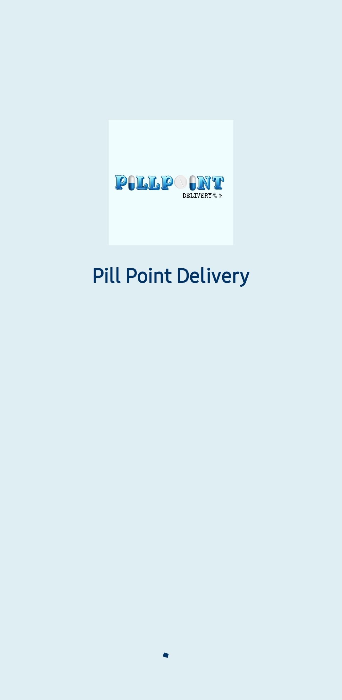 
      <b>Splash Page</b> 
      Displays the Pill Point Delivery brand identity before smoothly routing users into the authentication flow.
    </td>
    <td align="center" width="33%">
      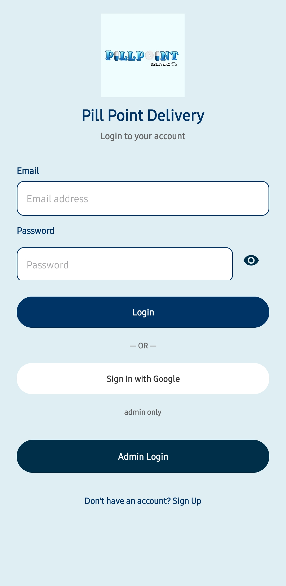 
      <b>Customer Login</b> 
      Upgraded to Firebase Authentication, enabling secure email/password sign-ins for returning customers.
    </td>
    <td align="center" width="33%">
      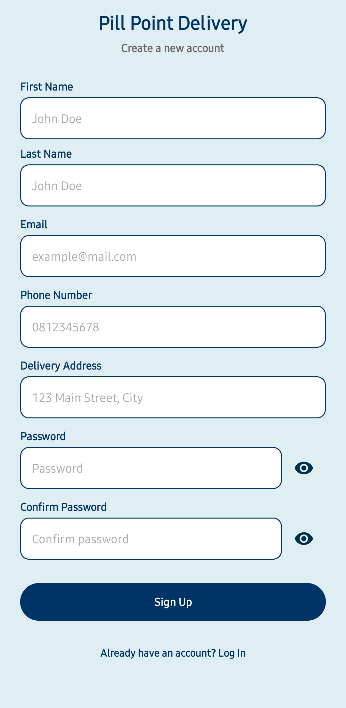 
      <b>Sign Up</b> 
      Live registration form that creates verified accounts and saves user profiles directly to Cloud Firestore.
    </td>
  </tr>
</table>

---

#### 2. Customer Core Features & Shopping

<table align="center">
  <tr>
    <td align="center" width="33%">
      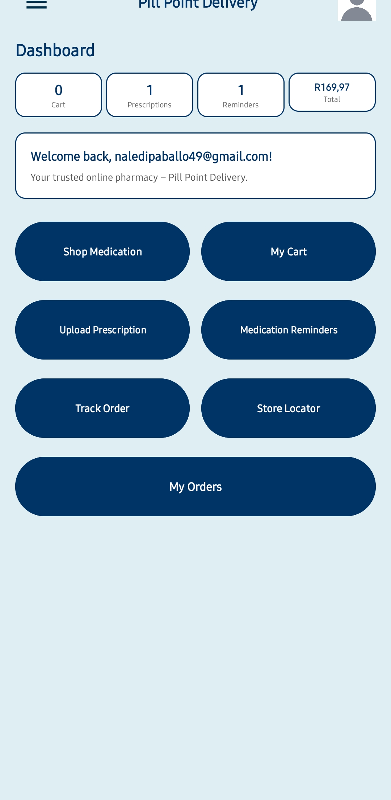 
      <b>Customer Dashboard</b> 
      Replaced static prototype placeholders with a refined healthcare UI and full navigation drawer.
    </td>
    <td align="center" width="33%">
      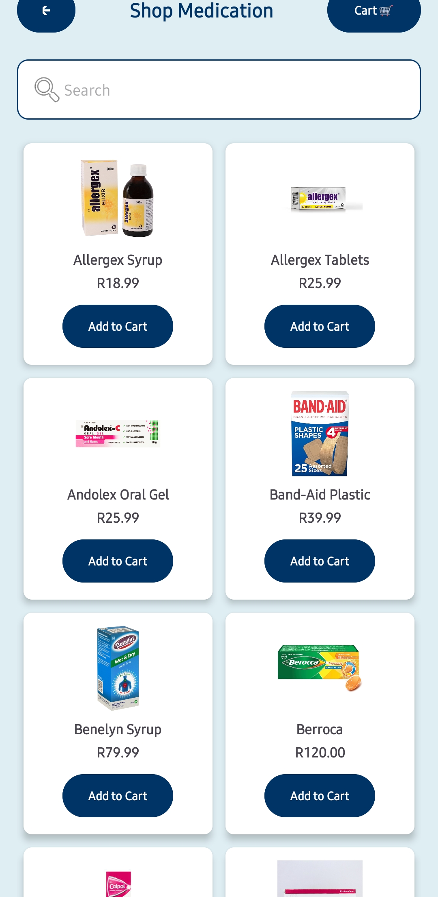 
      <b>Shop Medication</b> 
      Dynamic catalog pulling real-time medication availability and pricing directly from Firestore.
    </td>
    <td align="center" width="33%">
      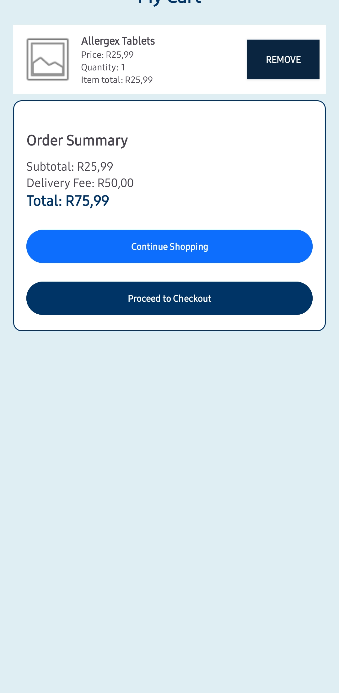 
      <b>Cart</b> 
      Upgraded from temporary local storage to a live Firestore-synced cart with automatic R50.00 delivery fee calculation.
    </td>
  </tr>
  <tr>
    <td align="center" width="33%">
      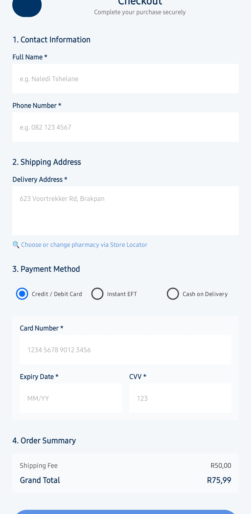 
      <b>Checkout</b> 
      Processes active orders securely, capturing delivery addresses and committing final order records to the cloud.
    </td>
    <td align="center" width="33%">
      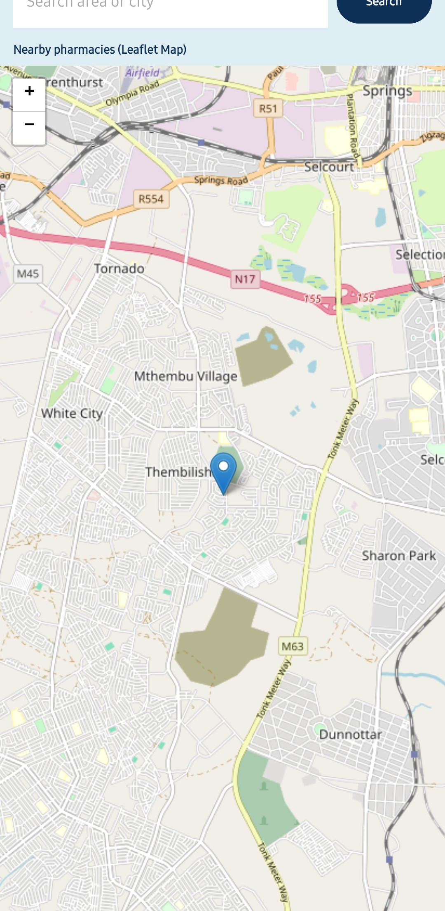 
      <b>Store Locator</b> 
      New interactive map and directory allowing customers to search and locate nearby partner pharmacies.
    </td>
    <td align="center" width="33%">
      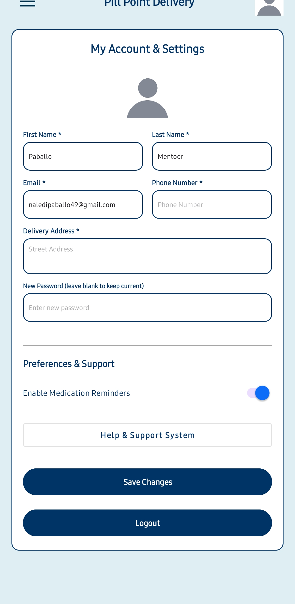 
      <b>My Account</b> 
      Allows users to view and update personal profile details, contact info, and saved addresses in real time.
    </td>
  </tr>
</table>

---

#### 3. Orders, Prescriptions & Reminders

<table align="center">
  <tr>
    <td align="center" width="33%">
      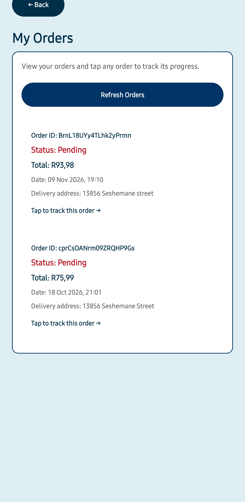 
      <b>My Orders</b> 
      Displays a live history of past and active medication purchases linked to the customer's account.
    </td>
    <td align="center" width="33%">
      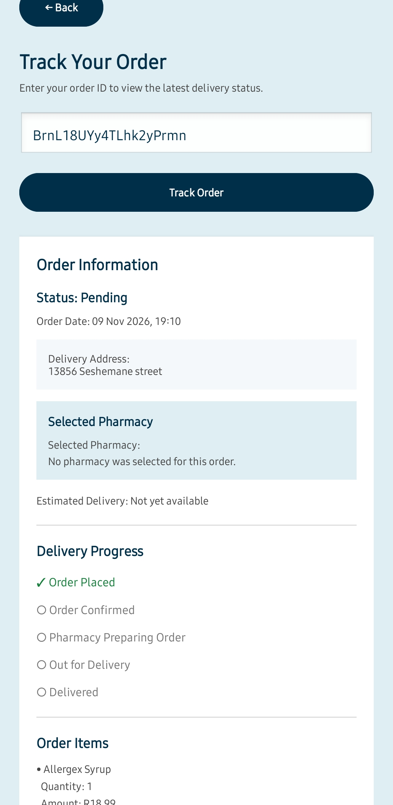 
      <b>Track Orders</b> 
      Real-time status tracker updating customers as orders move from pending to packaged and delivered.
    </td>
    <td align="center" width="33%">
      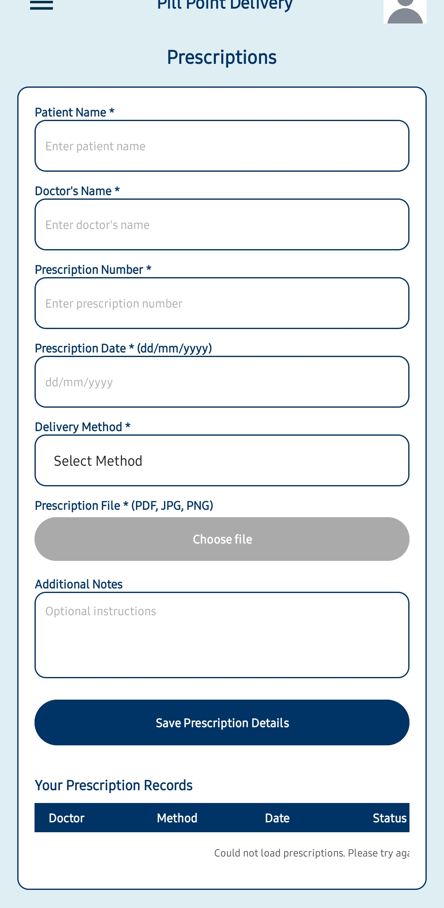 
      <b>Upload Prescriptions</b> 
      Upgraded from static mockups to a working digital submission tool for pharmacist review.
    </td>
  </tr>
  <tr>
    <td align="center" width="50%" colspan="1">
      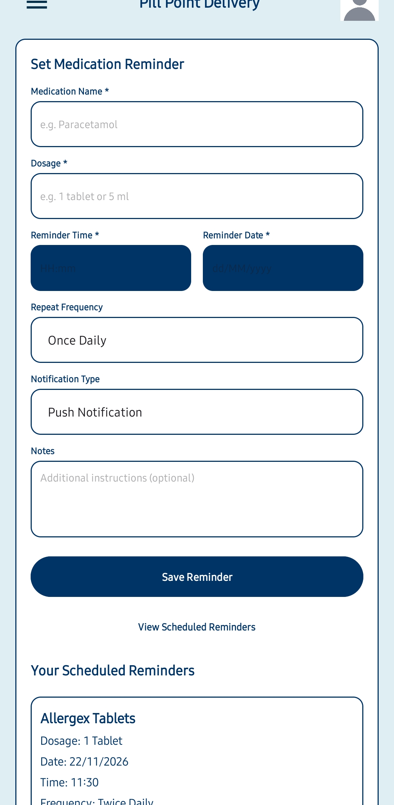 
      <b>Set Reminders</b> 
      New adherence configuration tool enabling users to schedule custom dosage alerts.
    </td>
    <td align="center" width="50%" colspan="2">
      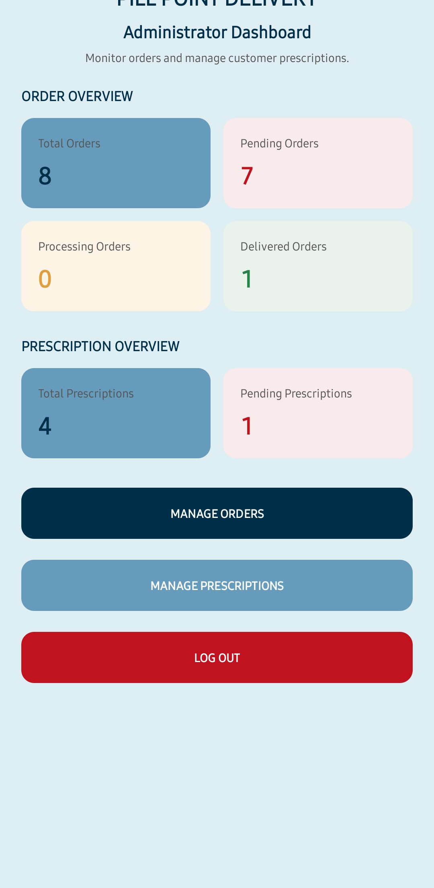 
      <b>View Reminders</b> 
      Organized dashboard displaying all active, upcoming, and completed medication schedules.
    </td>
  </tr>
</table>

---

#### 4. Administrator Portal

<table align="center">
  <tr>
    <td align="center" width="33%">
      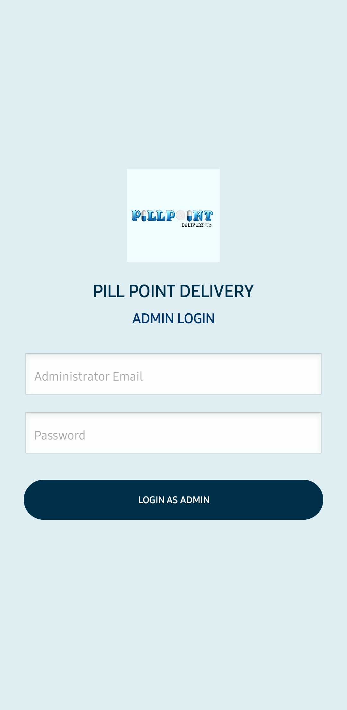 
      <b>Admin Login</b> 
      Role-restricted authentication gateway ensuring only authorized staff access management controls.
    </td>
    <td align="center" width="33%">
       
      <b>Admin Dashboard</b> 
      Centralized operations overview displaying live system stats, pending orders, and prescription queues.
    </td>
    <td align="center" width="33%">
      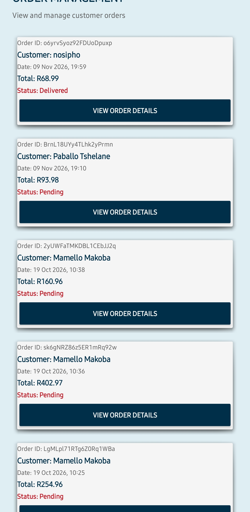 
      <b>Manage Orders</b> 
      Allows administrators to view incoming customer purchases and update delivery statuses in real time.
    </td>
  </tr>
  <tr>
    <td align="center" width="50%" colspan="1">
      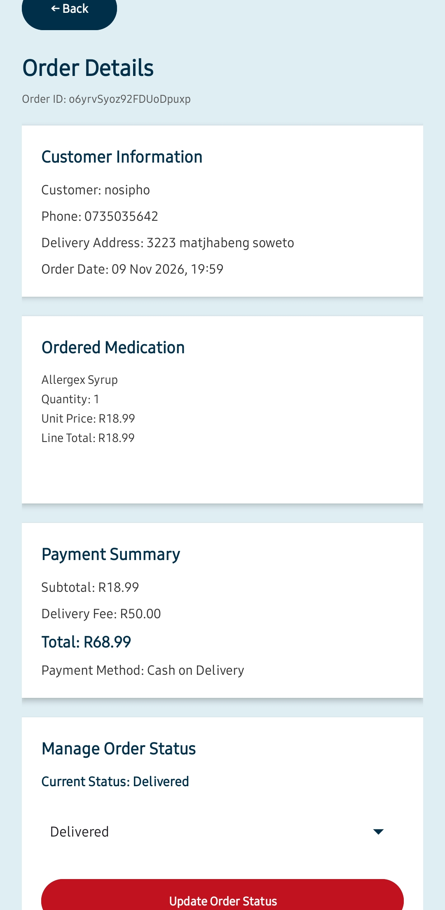 
      <b>Order Details</b> 
      Itemized breakdown of individual customer orders, including quantities, pricing, and delivery notes.
    </td>
    <td align="center" width="50%" colspan="2">
      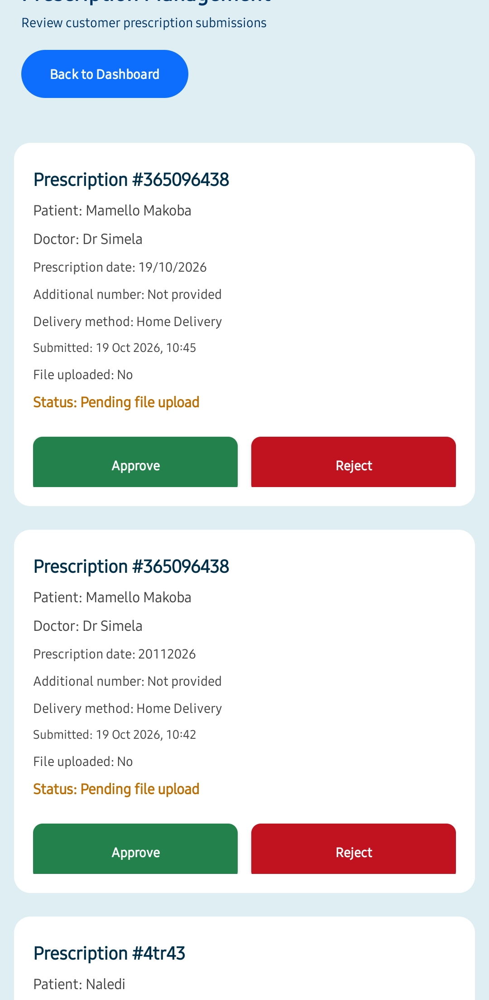 
      <b>Manage Prescriptions</b> 
      Verification queue where staff inspect uploaded digital prescriptions to approve or reject fulfillment.
    </td>
  </tr>
</table>

---

## App Demonstration Video on Google Drive
You can watch the complete walkthrough of the application features here:  
**[Video Demonstration](https://drive.google.com/file/d/1KQxV-Nwm1eCV6Cqw92SS3HsYRRRYzl27/view?usp=drivesdk)**

---
## Project Repository
View the full source code, GitHub Actions workflows, and documentation here:  
 **[GitHub Repository – xisd_app](https://github.com/Naledipaballo/xisd_app)**
